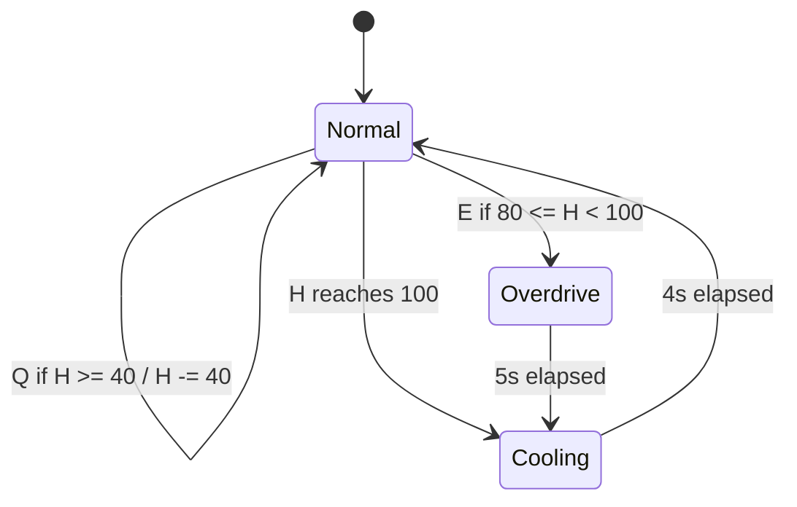

# MELTDOWN — 전투 설계

- 버전: v0.1.5 / 2026-11-26
- 상태: 초기 구현 및 튜닝 기준. 세부 수치는 확정 밸런스가 아니다.
- 상위 기획: [GAME_DESIGN.md](GAME_DESIGN.md)

## 1. 전투 원칙

직접 근접 공격과 회피를 기본으로 하며, 적의 탄막은 접근과 위치 선정에 의미를 준다. 고온에서 검기와 탄막 파괴로 주도권을 가져오는 것이 핵심이다. 공격·회피가 즉시 반응하고 적의 공격이 명확히 예고되어야 한다. 탄막은 접근을 불가능하게 만들 정도로 밀집시키지 않는다.

## 2. 조작

| 입력 | 동작 |
|---|---|
| WASD | 카메라 기준 지면 이동 |
| 마우스 | 지면 조준, 공격 방향 |
| 좌클릭 | 기본 근접 베기 |
| 우클릭 | 강공격 |
| Space | 방향 회피 대시(무입력 시 조준 방향 권장), 짧은 무적 |
| Q | 열 40 소모, 주변 열 방출 폭발 |
| E | 열 80 이상에서 오버드라이브 발동 |
| R | 게임 종료 상태에서 재시작(또는 UI 버튼) |
| Esc | 일시정지/재개. 포커스를 잃으면 자동 일시정지 |
| F1 | 표적 연습장/실전 전환 및 해당 모드 초기화 |
| 1 / 2 / 3 | 웨이브 사이 강화 선택 |
| M | 합성 효과음 켜기/끄기 |

입력 이름은 `move_left/right/forward/back`, `attack_light`, `attack_heavy`, `dodge`, `vent`, `overdrive`, `restart`를 권장하되 기존 프로젝트 입력 명명 규칙을 우선한다.

v0.1.1에서는 기존 `camera_*` 입력과 충돌하지 않도록 `md_*` 액션을 MELTDOWN 씬에서 런타임 등록한다. 좌/우클릭은 누르고 있으면 쿨다운마다 반복한다. R은 실전 도중에는 동작하지 않는다.

## 3. 기본 공격 및 회피

| 항목 | 초기 튜닝 제안 |
|---|---|
| 기본 공격 | 전방 부채꼴, 피해 10, 반경 1.8m, 전체 각 100°, 재사용 0.35초 |
| 강공격 | 더 넓은 전방 베기, 피해 22, 반경 2.6m, 전체 각 130°, 재사용 0.8초, 예고 약 0.18초 |
| 이동 | 지면 이동 5m/s |
| 회피 | 0.20초, 3m 안팎, 재사용 0.9초, 대시 구간 무적 |
| 플레이어 체력 | 100 |

- 공격 시작 시 방향을 고정하고 실제 타격 시점을 명시한다. 예고·타격·회복 구간을 구분한다.
- 한 번의 공격은 같은 적에게 한 번만 피해를 준다. 검기와 본체가 같은 대상에 중복 적중하는 문제는 attack ID를 공유해 막는 것을 초기 원칙으로 한다.
- 회피는 공격 회복 구간에서 사용 가능하도록 우선 튜닝하되, 타격 전 취소/입력 버퍼는 필요할 때 추가한다.
- 대시는 적/장애물/아레나 경계와의 충돌 규칙을 따른다. 벽 밖으로 빠지거나 무한 무적이 되면 안 된다.
- 시각적 공격 범위와 실제 판정은 일치해야 한다.

## 4. 열(Heat) — 통일된 초기 구현안

이전 기획에는 일반 회피 시 열 방출, 100%에서 공격 불가, 초과 열 120% 등 여러 제안이 있었다. 가장 최근 논의에 맞춰 다음과 같이 통일한다. 이는 프로토타입 기준으로 정리한 결정이며 이후 테스트에 따라 변경 가능하다.

### 열 획득과 소비

- 열 H는 평상시 0~100. 초기값 0.
- 기본 공격이 하나 이상의 적에게 적중하면 +10, 강공격은 +20. 빗나가면 +0.
- 한 공격 ID당 최대 한 번만 열을 얻는다. 광역 적중, 검기 등으로 무제한 증가하지 않는다. 초기안에서는 검기만 적중해도 해당 공격 ID로 한 번 충전할 수 있다.
- 기본안에서 적 탄환 파괴, 파편 피해, 열 방출, 연쇄 피해는 열을 충전하지 않는다.
- 일반 회피는 열을 소비하지 않는다. Q로 방출을 분리한다.
- 자연 냉각은 첫 프로토타입에서 제외. 전투 간 장기 정체가 문제라면 이후 비전투 감쇠를 테스트한다.
- 열 40 이상에서 Q 사용 시 정확히 40을 소비하고 원형 폭발(초기 피해 28, 반경 3.2m) 발생. 초기안은 탄막을 제거하지 않으며 열을 다시 생성하지 않는다.
- H >= 100 도달 시 즉시 강제 냉각으로 전환하며 H=0. 해당 타격은 타격 전 열 단계의 효과로 정상 처리한다.

### 열 단계(공격 시작 시 단계 스냅샷 권장)

| 열 | 단계 | 공격 변화 |
|---|---|---|
| 0~24 | NORMAL | 기본 근접 베기 |
| 25~49 | HEATING | 기본/강공격 반경 1.25배, 강화된 넉백 연출 |
| 50~79 | BURNING | 반경 1.4배, 기본/강공격에서 검기 발생 |
| 80~99 | CRITICAL | 반경 1.6배, 검기 유지, 강공격으로 범위 내 파괴 가능 적 탄환 제거, E 사용 가능 |
| OVERDRIVE | 5초 | 반경 2배, 피해 1.5배 예시, 큰 검기, 강공격 탄막 파괴 유지 |
| COOLING | 4초 | 기본 공격과 회피 가능, 열 0 고정, 모든 열 강화·Q·E 비활성 |

피해 배율·반경·검기 수치 등은 구현 시작값이다. 열 자체의 기본 피해 증가는 우선 최소화하고 공격 형태 변화의 효과를 먼저 검증한다. 검기 예시: 속도 12m/s, 수명 0.5초, 피해 기본 공격의 0.7배, 초기에는 첫 적 적중 시 소멸. 이펙트 및 판정의 길이가 일치해야 한다.

### 상태 전이

- E는 NORMAL 상태에서 H >= 80 및 H < 100일 때만 가능. 발동 순간의 열을 별도 UI로 표시하거나 OVERDRIVE 타이머로 대체한다. 120% 수치 표시는 연출일 뿐 별도 자원으로 구현할 필요가 없다.
- 발동 중에는 열 획득·Q·E를 잠그고 5초간 강화 고정. 종료 시 H=0, 강제 냉각 4초.
- 냉각 중에도 이동·기본/강공격·회피 가능. 열만 충전 불가.
- 열 80에서 +20 강공격을 하면 오버드라이브 없이 냉각될 수 있다. 위험을 UI와 사운드로 경고한다. 사용자가 선택하지 않은 냉각은 답답할 수 있으므로 실험 대상이다.
- 같은 프레임에 입력과 피해가 겹치면 처리 순서를 일관되게 유지한다(권장: 입력 상태 변경 → 공격/피해 → 열 갱신 → HUD). 사망하면 상태 타이머 중지.

## 5. 탄막 파괴

- 적 탄환은 기본적으로 회피해야 한다. 플레이어의 기본 공격/검기는 초기안에서 탄막을 지우지 않는다.
- CRITICAL 또는 OVERDRIVE의 강공격 판정 영역에 들어온 파괴 가능 탄환을 제거한다. 파편/섬광으로 명확히 표시한다.
- 탄환 제거만으로 피해 무적을 주지 않는다. 강공격 중에도 다른 방향 탄환은 위험하다.
- 파괴와 피격이 동일 프레임에 발생하면 일관된 순서를 적용한다(초기 권장: 유효한 강공격 파괴 먼저, 남은 탄환 피격 이후). 이 규칙을 테스트한다.
- 탄환은 플레이어 적중 시 1회 피해 후 소멸, 수명/경계 이탈 시 제거. 같은 탄환이 중복 피해를 주지 않는다.
- 특수 파괴 불가 탄환이나 탄환 반사는 MVP 제외. 추후 추가한다면 모양과 경고를 확실히 구분한다.

## 6. 적 설계 및 초기 파라미터

| 적 | HP(예시) | 행동·예고 | 공격 |
|---|---:|---|---|
| Spark Hound | 20 | 접근 → 약 0.25초 예고 → 근접 타격 → 회복 | 피해 8, 근접 1회 |
| Blast Node | 35 | 느린 이동/정지 → 방사 돌기 점등 약 0.5초 | 8방향 탄환, 피해 8, 약 2.5초 간격 |
| Forge Gunner | 30 | 적정 거리 유지, 조준 방향 표시 약 0.45초 | 3~5발 부채꼴, 피해 8, 약 2초 간격 |
| Molten Brute | 100~140 | 느린 추적 → 직선 돌진 범위 예고 약 0.7초 → 돌진 → 회복 | 피해 20, 장갑 손상 단계 표현 |

- 숫자는 프로토타입 튜닝 시작값. 공격 속도, 탄속(예시 4~7m/s), 탄막 발사 간격, 적 체력은 실험으로 변경한다.
- 기본 AI는 상태 머신(추적/위치 선정/예고/공격/회복/사망). 복잡한 행동 트리 불필요.
- 아레나는 개방형이므로 초기에는 간단한 분리/충돌 처리만 사용한다. 모든 적이 겹치거나 완전히 포위해 이동 불가능한 상황을 피한다.
- 탄막과 근접 공격 모두 피할 수 있는 경로 및 반응 시간이 있어야 한다. 스폰 시 플레이어 바로 옆에서 공격하지 않도록 한다.
- 중장갑형은 HP 구간별 장갑 조각 제거로 시작한다. 장갑 파괴가 실제 별도 내구도/약점 피해에 영향을 주는 방식은 후속 검증. 임시 모델만으로 구현한다.

## 7. 성장(초기 후보)

웨이브 사이 3택, 총 4~6개 정도의 강화 정의를 우선 권장한다. 선택 후 실제 전투에 반영된 효과를 HUD나 간단한 메시지로 표시한다.

| 강화 후보 | 초기 효과 제안 |
|---|---|
| Furnace Blade | 공격 반경 +15% |
| Heat Sink | 냉각 시간 -0.5초(최소 2초) |
| Thermal Blast | Q 방출 반경 +25% |
| Piercing Edge | 검기 추가 관통 1회 |
| Limit Break | 오버드라이브 +1초(최대 8초 등 상한 설정) |
| Bullet Breaker | 탄막 파괴로 열 회복(확장 후보, 공격당 +5 상한; 초기엔 제외 권장) |

강화는 데이터와 런타임 상태를 분리한다. 모든 강화를 한 번에 구현하지 않는다. SHATTER의 장갑 파괴 연쇄 피해는 이후 후보이며 MVP에서 무한 연쇄를 만들 필요가 없다.

## 8. UI와 피드백

- v0.1.2 Q: 피해 반경 3.2m 전체를 처음 0.08초 표시하고, 0.4초 동안 청록색 외곽 충격파가 반경 안에서 퍼진다. 8개 경량 증기 메시, 별도 저음 효과음, 0.65초의 `-40 HEAT` 안내를 사용한다. 충격파 이동은 연출이며 피해는 기존처럼 발동 순간 1회 적용한다.
- v0.1.2 E: 백열 코어와 발광 몸체, 시각적 검 크기 1.4배, 최대 6개의 0.3초 이동 잔상, 금색 발밑 링을 유지한다. 링의 호 길이는 남은 시간/강화 적용된 지속시간에 비례한다. 마지막 1초는 링 맥동과 1회 경고음으로 알린다. 새로운 피해 판정/버프는 추가하지 않는다.
- 냉각 시 코어·강화 검이 원래 상태로 돌아오고 잔상은 사라진다. 증기와 청록색 발밑 링, 별도 종료음으로 냉각 진입을 표시한다. Q/E 슬롯은 필요 열, 사용 가능, 공격 예고 중 대기, 발동 중 남은 시간, 냉각을 표시한다.
- 카메라는 플레이어를 고정 오프셋으로 따라가며 직교 크기 20을 사용한다. 맵 전체를 한 화면에 담지 않는다. 화면 밖 적은 가장 가까운 1개의 방향과 거리를 안내한다.
- HP, 현재 열 수치/단계, 열 80~99에서 E 가능 안내, Q 가능 표시, 오버드라이브/냉각 남은 시간.
- 100 도달 경고를 숫자·눈에 띄는 게이지 구간·소리로 전달한다.
- 일반/고온 공격 효과의 차이는 범위, 검기, 탄막 파괴 여부로 표현한다.
- 피해를 받은 원인을 알 수 있게 한다. 시각 효과가 적 공격 전조를 덮지 않도록 한다.
- 화면 흔들림/플래시 강도는 낮추거나 끌 수 있게 만드는 것을 권장한다.

## 9. 수용 기준

1. 공격이 빗나가면 열이 오르지 않고, 여러 적을 맞혀도 공격 ID당 한 번만 충전된다.
2. 25/50/80 경계에서 예정된 범위/검기/탄막 파괴가 작동한다.
3. Q는 열 40 미만에서 실행되지 않으며 정확히 40을 소비한다.
4. E는 80 미만, 냉각, 이미 오버드라이브 중에는 실행되지 않는다.
5. 100 도달 및 오버드라이브 종료 후 냉각이 4초 동안 유지되며 열을 얻지 못한다. 기본 공격과 회피는 된다.
6. 적 탄환은 일반 상태에서 위협적이고, 고온 강공격에서만 기본적으로 파괴된다.
7. 회피 무적은 정상 종료되며, 플레이어가 경계 밖으로 이탈하지 않는다.
8. 적 전조와 공격 방향이 읽히고, 피해 판정과 시각 효과가 일치한다.
9. 사망/재시작 시 열, HP, 적, 탄환, 타이머, 강화 상태가 초기화된다.

### 환경 전투 규칙 — v0.1.5 기둥 / 초기 튜닝값

| 항목 | 현재 값/동작 |
|---|---|
| 지지부 | HP 44. 기본 강공격 2회로 붕괴 예고, 블록 5개/층간 간격 1.02m |
| 정상 몸체 | XZ 반크기 0.55 × 0.55m. 전조 종료까지 이동/대시/근접/양쪽 탄환 차단 |
| 전조 | 1초. 위쪽 층일수록 전방으로 기울며 최종 기울기 0.22rad |
| 낙하 | 중력 12m/s². 층별 전진 속도 1.4 + 0.55 × 층 번호 m/s, 작은 고정 좌우 분산 |
| 블록 대표 충돌 | 수평 반경 0.68m / 수직 반높이 0.48m 원기둥. 외형은 0.96m 상자/Y축 회전 |
| 접촉 피해 | 움직이는 블록당 대상에게 최대 1회, 피해 18 |
| 밀침 | 유효 피해 시 진행 방향으로 플레이어 0.7m / 적 0.6m, 경계/온전한 구조물 충돌 적용 |
| 착지 | 중심 높이 0.48m에서 속도/피해 중단. 잔해는 유지하되 이동 차단 없음 |

- 상태: 정상 → 손상 → 전조 → 작동(낙하) → 소진(모든 블록 착지). 지지부 소진이나 전조 종료 순간에 부채꼴 피해를 주지 않는다. 최하단 블록은 바닥에서 바로 잔해가 되고 나머지 블록이 떨어진다.
- 이전/현재 블록·대상의 상대 XZ 선분과 높이 구간을 함께 검사한다. 플레이어 피해 몸체는 반경 0.35m/높이 1.2m, 적은 기존 반경과 높이 0.7m(Hound)/1.3m(나머지)이다. 머리 위나 옆으로 빗나가면 무피해다.
- 같은 블록의 접촉은 대상 ID로 한 번만 처리한다. 회피/피격 보호 중 접촉도 소비해 보호 종료 후 같은 블록이 재공격하지 않는다. 서로 다른 블록은 각각 적중할 수 있고 플레이어의 기존 0.45초 피격 보호를 따른다. E는 환경 면역이 아니다.
- 양쪽 모두 피해를 받으며 환경 피해·처치는 열을 충전하지 않는다. 환경 처치는 처치 수/웨이브 진행에는 반영한다. 블록으로 다른 구조물을 자동 연쇄 파괴하지 않는다.
- 일반/강공격·검기와 적 탄환이 지지부를 손상시킨다. 근접+검기의 동일 공격 ID 중복 방지와 E의 기존 공격 배율을 유지한다. 구조물 적중 자체는 열을 주지 않으며 Q는 지지부를 손상시키지 않는다. Brute는 온전한 기둥에서 정지한다.
- 기둥 위치(X,Z): `(-4,-2)`, `(5,3)`, `(-10,-10)`, `(12,-8)`. 1·3번은 +Z, 2·4번은 -Z 방향으로 붕괴한다. 방향은 미리 표시되며 전조 중 바뀌지 않는다.
- 착지 예상 원은 최종 착지 중심을 보여 주며 원 자체가 피해 판정은 아니다. 착지 전 몸체 높이에서 접촉할 수 있으므로 움직이는 블록과 그림자를 함께 읽는다. 기둥에는 기존 부채꼴 전조를 표시하지 않는다.
- 웨이브 사이 파괴 상태/잔해를 유지한다. 강화 선택·일시정지 중 낙하/전조도 정지한다. 한 판 다시 시작(R), F1 전환 시 원래 기둥으로 복구한다. 스폰은 온전한 기둥 내부와 전조/낙하 중 기둥의 보수적인 전방 위험 영역을 피한다.
- 평면 바닥용 낙하와 몸체 접촉만 구현했다. 블록 간 반발/쌓임, 임의 지형 충돌, 잔해 밀기/엄폐는 제외한다.
- 이전 배관(20 HP/0.85초/30 피해)과 장갑벽(44 HP/0.65초/24 피해)은 기본 배치에서 제외하고 C++ 회귀 검사는 보존한다. 주기형 함정·추가 열 연계는 미구현이다.

## 10. 변경 이력

### 실제 구현과 튜닝 가정 (v0.1.5 기준)

상기 기본 수치와 열 경계는 유지한다. 아래는 구현하면서 구체화한 사항이며 확정 밸런스가 아니다.

- 공격 시 방향·열 단계·배율을 고정한다. 기본 공격은 즉시, 강공격은 0.18초 예고 후 1회 판정한다. 위치는 타격 시 플레이어 위치를 사용하므로 예고 영역도 이동을 따라간다. 범위 판정은 적 중심에 대한 XZ 부채꼴이다.
- 검기는 **해당 기본/강공격 피해의 70%**, 속도 12, 수명 0.5초, 반경 0.4(오버드라이브 0.65)를 사용한다. 근접으로 이미 맞은 적은 무시하며 처음 새 적을 맞히면 사라진다. 동일 공격 기록으로 적중 ID와 열 충전을 공유한다.
- Q는 강공격 예고 중에는 사용할 수 없고, 사용 시 다음 공격까지 최소 0.35초 회복을 둔다. E는 공격 회복 중에도 가능하다. 이미 시작한 공격의 열 단계는 E를 눌러도 바뀌지 않는다. 대시는 타격 전 취소가 없으며 공격 회복 중에는 가능하다.
- 피격 후 0.45초 보호를 추가했다. 회피 0.20초 무적과 별개다. 탄환은 보호/대시 중 접촉해도 소멸한다. 피격 보호는 집중 탄막에 의한 같은 순간의 다중 피해를 완화하기 위한 초기 가정이다.
- 매 물리 틱: 상태 타이머 갱신 → E/Q 입력 → 회피·플레이어 이동 → 환경 타이머/발동/벽 개방 → 근접 판정/기존 탄막 파괴 → 적 AI·근접/돌진/발사 → 검기·남은 탄막 이동 및 피해 → 기둥 블록 이동·접촉·착지 → 웨이브/HUD. 그 틱에 새로 손상된 구조물은 다음 틱부터 전조 시간을 소비한다. 벽 개방 틱의 플레이어 이동은 개방 직전 상태를 사용하며 다음 틱부터 통과한다. 같은 틱에 새로 발사되는 탄환은 그 틱의 강공격 판정 이후 생성되므로 지워지지 않는다.
- 플레이어는 X/Z **±23m** 경계 안에 머문다(바닥 ±24m). 이동·대시는 0.15m 이하 분할과 원형 적 몸체/사각 벽 충돌을 사용한다. 빠른 탄환은 플레이어의 이전/현재 위치에 대한 상대 선분 검사, 벽은 확장 사각형의 선분 진입 시각을 비교해 가장 먼저 닿는 대상을 처리한다. 돌진은 분할 이동과 선분/원 거리 검사로 처리한다. 탄환은 바닥 ±24m를 벗어나면 제거한다. 현재 명시된 평면 벽 전용이며 임의 Godot 물리 노드와 자동 연동하지 않는다.
- Spark Hound: HP 20, 이동 2.1m/s, 사거리 1.6m/110°, 예고 0.25초, 회복 0.9초, 피해 8. Blast Node: HP 35, 정지, 예고 0.5초, 방사 8발, 탄속 4.5m/s, 회복 2초, 피해 8.
- Forge Gunner: HP 30, 거리 4~6m 유지, 이동 1.4m/s, 방향 고정 예고 0.45초, 5발/약 41° 부채꼴, 탄속 6m/s, 회복 1.55초, 피해 8. 바닥 부채꼴은 조준 방향 예고이며 탄환은 그 너머로 계속 이동한다.
- Molten Brute: HP 120, 이동 1.2m/s, 예고 0.7초 후 방향 고정 10m/s·0.6초 돌진, 피해 20을 돌진당 최대 1회. 회복 1.4초. 8개 장갑 파츠가 HP 비율에 따라 숨겨지며 별도 장갑 내구도는 없다. 돌진 전조는 몸체/플레이어 반경을 포함한 캡슐 영역이다.
- 적 탄환 수명 5초, 투사체 총 상한 256, 파편 상한 128/수명 0.45초. 공격 파괴만으로 열은 증가하지 않는다.
- 웨이브 적 수(추적/방사/사격/중장갑): `6/0/0/0`, `6/2/0/0`, `4/2/2/0`, `5/2/2/1`, `6/3/3/2`. 스폰은 플레이어 주변 반경 8.5m의 재현 가능한 후보를 택하고 경계 밖은 보정한다. 최소 5m 거리, 벽/전조 회피를 만족하지 않으면 각도를 바꿔 최대 64개 후보를 검사한다. 현재 기둥 4개 배치용이며 밀집 맵을 추가할 때 스폰 실패 처리도 확장한다. 최소 1초 준비 시간을 둔다.
- 강화 선택 동안 전투·열 타이머를 멈추고 투사체/공격/회피를 정리한다. 선택 시 HP +20(최대 100), 다음 웨이브를 시작한다. 열 수치·진행 중 오버드라이브/냉각은 선택 화면 동안 보존한다.
- 강화: 반경 +15%씩 최대 3회(합산), 냉각 -0.5초씩 최대 4회(최소 2초), 오버드라이브 +1초씩 최대 3회(최대 8초). 최대치인 선택지는 선택을 소비하지 않는다. 다른 후보는 미구현이다.
- 검증: 순수 C++ 경계/충돌/상태 테스트, Godot 입력·표적 테스트, 3회 자동 전투/사망/재시작, D3D12 전투 캡처를 수행했다. 실제 수치·미검증 항목은 ROADMAP에 기록한다.

- v0.1.5 / 2026-11-26: 기둥 4개로 기본 배치 전환. 블록별 중력·높이 포함 접촉·밀침·착지/재시작을 기록.
- v0.1.4 / 2026-11-25: 배관/벽 수치·배치·발동·양쪽 피해·엄폐·초기화·스폰 및 프레임 처리 순서를 실제 구현에 맞춰 확정. 추가 열 연계는 미구현.
- v0.1.3 / 2026-11-25: 미구현 환경 전투의 양쪽 피해·전조·파괴/통행·중복 방지·교체 후 검증안을 추가. 열/Q/E 연계는 후보로 유지.
- v0.1.2 / 2026-11-25: 48m 바닥/±23m 이동 경계, 근거리 추적 시점, 플레이어 주변 스폰, Q 충격파 및 E/냉각 상태 표현 반영. 피해·열 비용·지속시간은 유지.
- v0.1.1 / 2026-11-25: 실제 전투 처리 순서, 적 수치, 입력, 보호 시간, 5웨이브/3강화와 검증 범위를 동기화.
- v0.1.0 / 2026-11-25: 직접 근접+적 탄막, 열 단계·방출·오버드라이브·냉각을 하나의 명세로 정리. 이전 상충안은 Q/E 분리와 냉각 중 기본 전투 유지로 통일. 표의 세부 수치와 판정 경계 처리는 첫 테스트용 제안.
