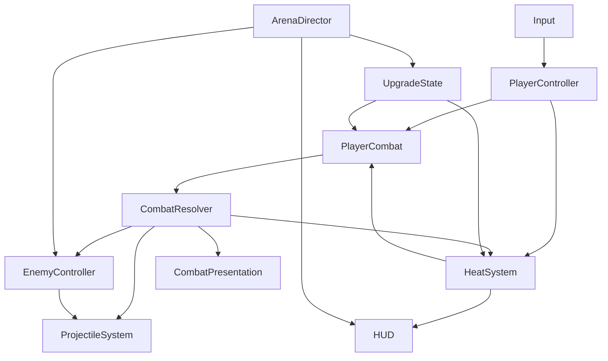

# MELTDOWN — 기술 설계

- 버전: v0.2.3 / 2026-11-26
- 상태: 기존 빌드 조사, 순수 C++ 전투 및 Godot 연결 구현, Windows Debug/Release DLL 빌드와 Debug 실행 검증.
- 참조: [GAME_DESIGN.md](GAME_DESIGN.md), [COMBAT_DESIGN.md](COMBAT_DESIGN.md), [ROADMAP.md](ROADMAP.md)

## 1. 기술 기준 및 기존 프로젝트

- 대상은 Codex에 연결된 기존 `Project_Empty` Godot C++ GDExtension 프로젝트다. 이 문서는 신규 프로젝트 생성 요청이 아니다.
- 정확한 Godot 4.x 버전, godot-cpp 리비전, SCons/CMake 빌드 설정, 플랫폼, 등록 진입점, 현재 씬과 InputMap을 먼저 확인한다. 확인 없이 특정 버전으로 업그레이드하거나 기존 빌드 체계를 바꾸지 않는다.
- 핵심 게임 로직은 C++. C++ 표준은 기존 프로젝트와 godot-cpp 호환 범위를 따른다. 기존 씬, Resource, 셰이더, 에디터 기능을 활용한다. UI·연출용 보조 스크립트는 명확히 필요할 때만 사용하고 핵심 전투 규칙을 중복 구현하지 않는다.
- 확인 환경: Godot `4.7.2.stable.official.ed1daf0bf`, godot-cpp API 4.7 / 기존 스냅샷 `cedbd9e71b24eb2898b28867c5faf6114da9e5e2`, C++17, MSVC v145, SCons, 기존 로컬 Windows SDK. 엔진/의존성/빌드 스크립트는 교체하지 않았다.
- 복셀 스타터 프로젝트를 새로 가져올 필요 없음. 기존 복셀 코드가 있다면 삭제하지 않고, 실제 사용 필요성이 검증될 때만 통합한다.

## 2. 책임 분리(가벼운 구조)

아래 클래스명은 권장 예시다. 기존 프로젝트의 명명·폴더 관례를 우선하고, 필요하지 않은 매니저/인터페이스는 만들지 않는다.

실제 구현은 순수 C++ 모델과 Godot 표현으로 나눴고, v0.2.0에서 복셀 데이터/구현 파일을 추가했다. 표의 모든 권장 클래스를 생성한 것은 아니다.

| 실제 파일 | 책임 |
|---|---|
| `cpp/src/meltdown_sim.h/.cpp` | Godot 의존성이 없는 XZ 전투 모델. Heat, Attack/AttackRecord, 적/투사체/파편, 환경 상태·양쪽 피해·벽 충돌/우회, 강화, 웨이브·결과·초기화 |
| `cpp/src/meltdown_arena.h/.cpp` | 등록 노드 MeltdownArena. 키/마우스 입력 변환, 물리 틱 호출, 메시/HUD/합성음, 포커스 일시정지 |
| `cpp/src/dungeon_grid.h/.cpp` | 1m 정수 셀, 8m 청크, 변경 버전, 구간 질의·sweep, 청크 경계를 넘는 지지 연결 검사. Godot 의존 없음 |
| `cpp/src/meltdown_dungeon.cpp` | Simulation의 던전 배치·셀 피해·붕괴 전조/낙하 전환·착지 예상. 새 등록 클래스 없음 |
| `cpp/src/meltdown_dungeon_view.cpp` | MeltdownArena의 변경 청크별 노출 면 생성 및 교체 가능한 지형 Material 연결 |
| `tests/dungeon_grid_test.h`, `tests/meltdown_dungeon_test.gd` | 음수/경계/충돌/연결·모델 전투, 실제 입력·GPU·표현 교체·먼 청크 보존·복원 |
| `scenes/meltdown.tscn` | 직교 카메라, 조명/환경, HUD와 실제 게임 루트. 프로젝트 기본 실행 씬 |
| `scenes/environment/*.tscn`, `*_visual.gd` | 기본/대체 기둥 블록과 이전 배관·벽 표현. 메시/균열/재질 전용, 피해·중력·충돌 규칙 없음 |
| `tests/meltdown_environment_test.gd` | 실제 입력의 기둥 손상/낙하/양쪽 피해/통과/복원 및 두 외형 비교. `-- capture`로 GPU 캡처 |
| `tests/meltdown_sim_test.cpp` | 순수 C++ 상태·충돌·공격 테스트, 사망/클리어/강화/재시작 및 결정적 봇 실행 |
| `tests/meltdown_scene_test.gd` | 실제 씬·InputMap·마우스 조준·타격/열·포커스·재시작 검증 |
| `tests/meltdown_feedback_test.gd` | 실제 Q/E 입력과 효과 수명·냉각 전환·큰 맵 이동·카메라/화면 밖 적 안내·초기화 검사. `-- capture`로 GPU 캡처 |
| `tests/meltdown_playthrough.gd` / `meltdown_visual.gd` | 실제 Godot 입력 3회 재생 / GPU 화면 캡처. 핵심 게임 규칙은 중복 구현하지 않음 |

기존 EntryPoint/GameInput/GameCamera, `scenes/main.tscn`, 복셀 코드·자산을 보존했다. `register_types.cpp`에 클래스 등록을 추가하고, `build_profile.json`에 BoxMesh/Label/InputMap/AudioStreamPlayer/AudioStreamWAV/PackedScene을 추가했다. 기존 SConstruct의 `src/*.cpp` 수집을 사용하며 vcxproj에는 파일 목록만 추가했다. `project.godot` 변경은 기본 실행 씬 한 줄이다. v0.1.4에서는 기존 MELTDOWN 모듈과 씬을 확장했으며 새 C++ 등록 클래스나 빌드 도구는 도입하지 않았다.

### v0.1.6 코드 정리

- 긴 `MeltdownArena::present()`를 환경 → 플레이어 → 적 → 공격 → 투사체 → 파편 → HUD 순서의 역할별 함수로 나눴다. 호출 순서와 표시 조건은 유지한다.
- 열 단계 색상은 `heat_color()`, PackedScene 생성·Node3D 확인·자식 등록은 `instantiate_visual()`로 모았다. 외형 리소스 교체 속성과 기본 메시 대체 동작은 유지한다.
- 환경 종류를 두 bool 대신 `EnvironmentKind::{Pipe, Wall, Pillar}`로 표현한다. `get_snapshot()`의 기존 `wall`/`pillar` bool 키는 열거형에서 계산해 테스트·Godot 연결 계약을 보존한다.
- 기둥 생성은 `Simulation::create_environment()`로 분리하고 블록 수·층 간격·기울기를 이름 있는 상수로 모았다. 값, 생성 순서, ID, 전투 규칙은 바꾸지 않았다. 새 모듈·등록 클래스·빌드 설정은 추가하지 않았다.

| 클래스 또는 모듈 | 책임 |
|---|---|
| PlayerController | 이동, 조준, 입력, 대시 상태, 캐릭터 표시 연동 |
| PlayerCombat | 공격 시작/예고/타격/회복, 공격 ID, 피해 요청, 검기 생성 |
| HeatSystem | 열 단계, 증가/소모, 오버드라이브 및 냉각 상태 머신 |
| CombatResolver | 범위·방향 판정, 피해 적용, 중복 적중 방지, 탄막 파괴 |
| EnemyController | 적 유형별 상태 머신, 공격 예고 및 이동 |
| ProjectileSystem | 적 탄환·플레이어 검기 생성/이동/수명/판정 |
| ArenaDirector / RunState | 스폰, 웨이브, 보상, 승패, 재시작 |
| UpgradeState | 런 내 강화 적용과 상한 |
| CombatPresentation | 파편, 검기, 섬광, 히트스톱, 사운드, 카메라 효과 |
| HUD | HP, 열, 상태, 웨이브, 입력 안내, 결과 |



- `HeatSystem`은 가능하면 Godot 씬 의존성이 낮은 C++ 로직으로 작성하고 단위 테스트 가능하게 한다.
- `PlayerController`와 `EnemyController`는 Godot Node/CharacterBody3D 기반으로 등록 가능. 계산과 표현의 상태 소유권을 명확히 한다.
- 이벤트는 필요한 범위에서 직접 호출 또는 Godot signal을 사용한다. 전역 이벤트 버스, ECS, 서비스 로케이터, 복잡한 DI를 선제 도입하지 않는다.

## 3. 권장 씬 트리(논리 구조)

```text
Main (Node3D)
├── Arena (Node3D)
│   ├── Floor / Boundary (static collision)
│   ├── EnemyContainer (Node3D)
│   ├── ProjectileContainer (Node3D)
│   └── EffectContainer (Node3D)
├── ArenaDirector
├── Player (CharacterBody3D)
│   ├── CollisionShape3D
│   ├── VisualRoot (Node3D)
│   │   ├── BodyMesh
│   │   └── WeaponPivot / WeaponMesh
│   └── Combat / Hit feedback (필요한 노드만)
├── CameraRig (Node3D)
│   └── Camera3D
├── Lighting / WorldEnvironment
└── HUD (CanvasLayer)
    ├── HP / Heat / State / Wave
    ├── UpgradePanel
    └── ResultPanel
```

카메라는 고정 회전의 쿼터뷰, 직교 투영 우선. 지면과 전투 범위가 잘 보이면 원근 투영도 가능하다. WASD는 카메라 지면 방향을 기준으로 변환하고, 마우스는 카메라 광선과 지면 평면의 교점으로 조준한다. 대시와 이동은 XZ 평면 중심이며 Y는 고정 또는 제한한다.

현재 실제 Player는 Node3D 아래의 기본 메시와 WeaponPivot이다. 평면 아레나에서는 CharacterBody3D/Jolt 충돌 대신 모델의 원형 몸체·분할 이동·선분 충돌을 사용한다. v0.2.0에서는 1m 셀 충돌과 평면 격자 우회를 추가했다. 고저차/임의 회전 구조물/다층 내비게이션은 지원하지 않는다. 카메라는 고정 각도의 **플레이어 추적 직교 카메라**이며 size=20이다. 플레이어 위치에 초기 카메라 오프셋을 더해 매 물리 틱 갱신한다. 조준은 해당 틱 이동 전 화면의 광선을 사용하고, 이동 후 표현 단계에서 카메라를 동기화한다. 경계에서도 동일한 오프셋을 유지하며, 재시작 때 원점으로 복귀한다. 적·투사체·파편 노드는 모델 ID와 연결하여 생성/삭제하며 queue_free를 사용한다. 모델 컨테이너는 순회 후 삭제한다.

`meltdown_sim.h`의 `arena_half_size=24`, `arena_limit=23`을 바닥·그리드·외곽선·이동·스폰·탄환 수명의 공통 기준으로 쓴다. 맵을 넓힌 뒤 옛 ±12m에서 탄환이 사라지는 문제를 방지한다. 적 스폰은 현재 플레이어 위치 기준이며 9개 중앙/변/모서리 위치에서 안전 거리와 경계 조건을 테스트한다.

Q의 피해 반경/연출 수명은 `vent_radius`, `vent_effect_duration`으로 공유한다. 공격과 Q의 재질을 분리해 검기 색 변화가 충격파 색에 섞이지 않게 한다. Q 충격파와 E/냉각 링은 ArrayMesh, 증기는 고정 8개 메시, 잔상은 최대 6개 메시를 재사용한다. 표현 타이머는 시뮬레이션 진행 시간만큼 감소하므로 일시정지/결과/강화 선택에서는 멈춘다. 재시작 시 타이머·잔상을 초기화한다. 추가 엔진 클래스나 빌드 의존성은 도입하지 않았다.

## 4. 공격 및 열 처리 계약

- `AttackSpec`: 공격 종류, 피해, 사거리, 각도, 타격 지연, 쿨다운, 열 증가량, 열 단계에서 계산된 플래그 등.
- `AttackContext`: 고유 attack ID, 시전자, 시작 방향, 시작 시 열 단계 스냅샷, 이미 피해를 준 대상 집합, 열 획득 여부.
- `DamageResult`: 유효 적중, 실제 피해량, 처치, 장갑 손상 여부 등.
- `HeatState`: Normal / Overdrive / Cooling, 수치와 남은 시간. 상태 전이는 COMBAT_DESIGN의 명세를 따른다.
- 수치의 단일 소유자 유지. HUD나 셰이더가 열을 직접 변경하지 않는다.
- 공격 전진 방향과 범위는 타격 시점에 고정된 스냅샷을 사용한다. 검기가 지연 적중하는 경우 공격 ID와 수명이 유지되어야 한다. 오래된 공격이 오버드라이브/냉각을 넘겨 열을 부정하게 추가하지 않도록 초기에는 상태 전이 시 세대 ID를 증가시켜 이전 세대의 열 충전을 거부하는 방식을 권장한다.
- 물리 프레임 중심으로 이동·피해·충돌을 처리한다. 쿨다운과 타이머는 delta 기반으로 프레임 속도와 무관하게 동작하도록 한다. 화면 효과/히트스톱이 타이머에 미치는 영향은 일관되게 정한다.
- 한 프레임에 객체를 제거하면서 순회 중인 컨테이너를 무효화하지 않도록 삭제 예약 또는 안정적 ID를 사용한다. Godot 노드의 생명주기를 존중한다.

### 전투 프레임의 권장 순서

다음은 최초 권장안이다. 실제 v0.1.1은 플레이어 공격을 적 AI보다 먼저 처리하며, 정확한 순서는 COMBAT_DESIGN 10절을 따른다. 모델 `_physics_process` 호출은 기본 60Hz, delta 기반이며 0~0.1초 범위의 유효 delta만 받는다. 사망/결과/강화 선택/일시정지에서는 진행을 멈춘다. 현재 히트스톱은 없어 전역 시간 배율을 바꾸지 않는다.

1. 입력 및 플레이어 상태 전이(E/Q, 대시 포함).
2. 이동, 적 AI, 공격 예고·타격 예약.
3. 공격 판정 및 파괴 가능 탄환 제거.
4. 남은 적 탄환 이동/피격, 적 공격 피해와 적 사망 처리. 공격에 따른 열 갱신은 중복 없이 처리한다.
5. 상태·웨이브 갱신, 시각 효과와 UI 갱신.

Godot 노드별 콜백 순서에만 의존하지 말고 필요한 충돌 처리 순서를 명시한다. 실제 구현에서 순서 조정이 필요하면 COMBAT_DESIGN의 판정 계약과 테스트를 함께 갱신한다.

## 5. 탄막과 물리

- 레이어 예시: World, PlayerBody, EnemyBody, EnemyProjectile, PlayerProjectile. 실제 번호는 기존 설정과 충돌하지 않도록 조사 후 결정.
- 근접 공격은 `intersect_shape` + 방향 검사 또는 단순 XZ 거리/내적 기반 판정으로 시작한다. 범위가 넓은 탄막 파괴도 동일한 시각적 부채꼴 기준 사용.
- 빠른 대시·탄환은 이전 위치에서 현재 위치까지 sweep 또는 ray/segment 검사를 고려하여 터널링을 방지한다.
- 초기 탄환은 단순 위치/속도/수명 데이터로 충분. Area3D 등 기존 구조가 적합하면 재사용한다. 실제 병목이 나타난 후 풀링, 일괄 업데이트, MultiMesh를 도입한다.
- Godot 내비메시는 사용하지 않는다. 열린 시야는 방향 벡터로 이동하고, 복셀 벽으로 막히면 점유 격자의 A*와 몸체 여유 검사로 우회한다.

## 6. 복셀과 파괴 연출

v0.2.0 사용자 요청으로 제한된 복셀 던전을 구현했다. 아래 1m 격자·청크 재메싱·연결 분리는 현재 범위에 포함하며, 무한 월드·Godot 동적 삼각형 콜라이더 재생성·개별 블록 RigidBody는 도입하지 않는다.

### 1m 격자와 공간 분할

- 월드 1단위 = 1m. 셀 `(x,y,z)`는 `[x,x+1) × [y,y+1) × [z,z+1)`을 점유하고 중심은 `+0.5`다. 모든 축의 월드→셀은 floor, 셀→청크는 음수를 보정한 floor division이다. 예: 셀 -1은 청크 -1/로컬 7, 셀 -9는 청크 -2/로컬 7.
- `DungeonGrid`는 청크 좌표를 키로 한 map과 청크 내부 8³ 셀 배열이다. 초기 48m 바닥/벽/기둥 배치는 44개 청크, 바닥 2,304셀, 벽 54셀, 기둥 20셀이다. 저장 청크 수는 비어 있는 높이 영역을 포함한 공간 배치에 따른다.
- 셀 변경 시 자기 청크와 맞닿은 면의 이웃 청크 버전만 변경한다. 메시 생성은 노출된 면만 포함하며 청크 밖 이웃도 조회한다. 숨은 면·중복 경계 면 없이 청크별 ArrayMesh로 묶는다. 현재는 면별 쿼드이며 greedy meshing/옥트리/스트리밍은 없다.
- 공격/이동/sweep의 AABB가 겹치는 청크와 셀만 조회한다. 빠른 탄환/낙하 블록은 후보 셀의 확장 AABB와 선분 진입 시각을 비교한다. DDA는 사용하지 않았으며 큰 월드/긴 대각선은 후보 범위 비용을 다시 측정해야 한다.
- 벽 이동 충돌과 공격 차단의 기준은 같은 점유 데이터다. 파괴 상태가 바뀐 물리 틱에서 충돌도 변경하고 이어지는 표현 갱신에서 청크를 다시 만든다. Godot 물리 콜라이더와 중복 소유하지 않는다. 임의 Godot RigidBody/CharacterBody가 자동으로 이 지형에 충돌하는 기능은 없다.
- 적 우회는 현재 평면 영역의 1m 격자 A*이며 몸체 여유와 높이를 검사한다. 선택한 다음 지점까지 이동하도록 유지해 모서리에서 경로가 왕복하지 않게 했다. 직접 시야가 열리면 직선 이동으로 돌아간다. 복잡한 다층/대규모 내비게이션은 대상이 아니다.

### 파괴, 지지와 낙하

- 벽 셀의 HP/종류/전조는 `DungeonGrid`가 소유한다. 기존 기둥은 `EnvironmentObject`의 지지부 HP·전조와 `FallingBlock`의 외형을 유지하고, 1m 셀에 소유자 ID로 등록한다. 기둥 전조 종료 때 해당 셀을 비우고 벽 지지를 다시 검사한다.
- 한 근접 공격의 대상 셀을 먼저 수집한 뒤 피해를 일괄 적용한다. `AttackRecord::hit_cells`로 직접 타격과 같은 공격의 검기 중복을 방지한다. 셀에 피해를 줘도 열을 충전하지 않는다.
- 여섯 면 연결로 벽 성분을 탐색한다. 청크 경계를 넘어 바닥/기둥에 연결되면 유지하고, 끊긴 성분은 1초 예고 후 전체를 비운 다음 낙하 블록으로 만든다. 현재는 작은 던전의 벽 전체 연결을 파괴 사건 시 검사하며, 청크마다 독립 붕괴시키지 않는다. 구조 강도/하중은 계산하지 않는다.
- 벽 조각은 수직 낙하, 기둥 조각은 기존 방향성 탄도 운동이다. 낙하 충돌은 1m 축 정렬 상자, 대상 몸체의 수평 반경으로 확장한 상대 선분과 높이 구간이다. 바닥/고정 셀에 닿는 시점까지만 접촉 피해를 검사하고 정지한다. 쌓임·반발·회전·잔해 재복셀화는 없다.
- 착지 예상은 1/60초 간격의 탄도 sweep으로 현재 고정 지형을 조회한다. 착지 원의 높이도 지형 접촉 높이를 따른다. 굵은 틱/벽 모서리에서 예측과 실제 접촉에는 근사 오차가 있을 수 있으며 원은 피해 영역이 아니다.
- 현재 배치의 파괴 가능 셀은 총 74개로 한 판의 큰 조각 수도 그 이하로 제한된다. 런타임 지형 추가/무한 생성은 없다. 더 큰 맵을 도입할 때 활성 낙하 개수, 연결 탐색, 재메싱의 프레임 예산을 먼저 설정한다. 8m와 16m 청크의 성능 비교는 아직 하지 않았다.

### 표현 리소스 계약

v0.2.2에서 작은 복셀 샘플 생성기/시각 스크립트/셰이더/씬 6개와 `detail_pillar_visual` C++ 속성을 제거했다. 기본 씬과 환경 테스트는 기존 두 외형으로 복원했다. v0.2.3은 이 형상 위에 석재/잉크 렌더링을 적용한다. 지형 모델·8m 청크·카메라·프로젝트 설정은 유지한다.

- `scenes/meltdown.tscn` 루트의 `dungeon_material`은 교체 가능한 Material이다. 기본 `dungeon_stone.gdshader`는 면별 UV 0..1과 셀 상태의 vertex COLOR로 바닥/벽·손상·예고를 구분한다. 바닥에는 줄눈을 표시하지 않으며 벽에는 1m 줄눈을 유지한다. 교체 셰이더도 전조/손상 구분을 유지해야 한다. 사용자 지정 셰이더가 이를 무시하는 경우는 보장하지 않는다.
- 고정 지형 형상은 1m 큐브의 노출 면이다. 재질·텍스처 교체가 점유나 HP를 바꾸지 않는다. 임의 모양의 고정 메시로 바꾸려면 노출 면 생성 계약을 별도로 확장해야 한다.
- 기둥과 떨어진 벽 조각은 기존 `pillar_block_visual` PackedScene을 공유하며 중심 피벗/1m 외형을 따른다. 기본/대체 씬 모두 1m로 갱신했다. 교체 가능한 효과음 속성은 유지한다.

### v0.2.3 석재/잉크 렌더링

- `dungeon_stone.gdshader`: 노출된 `floor_color`, `wall_color`, `ink_color`, `texture_strength`로 팔레트/무늬를 조정한다. 기둥은 `terrain_palette=false`와 상태별 `tint`를 사용한다. 로컬 좌표에 고정된 얼룩/긁힘은 낙하 블록과 같이 움직이며 시간 노이즈나 추가 형상을 생성하지 않는다.
- 환경 재질은 ambient/specular를 끄고 custom `light()`에서 입사각 3단계와 그림자 감쇠를 잉크색에 혼합한다. 현재 씬의 단일 DirectionalLight 기준이다. 추가 광원/다른 렌더러는 미검증이다. 일반 도형 재질은 기존 C++ 생성 헬퍼의 toon diffuse / specular disabled를 사용한다.
- `scenes/meltdown.tscn`은 선형 톤매핑, 보라색 배경/주변광, Sun 에너지 1.0을 사용한다. 환경 상태별 재질과 공격 전조 외의 전투 수치는 유지한다.
- 카메라 자식 `InkOutline`은 `ink_outline.gdshader`의 화면 색/깊이를 읽는 QuadMesh다. reverse-Z 깊이를 view 공간으로 복원한 뒤 이웃 4픽셀과의 차이를 비교한다. 기본 두께 1px, 깊이 경계 0.16m, 잉크 혼합 0.85다. 깊이 경계 기반이므로 같은 깊이의 재질 경계/모든 면 경사를 검출하는 방식은 아니다.
- `render_priority=-128`, 깊이 쓰기/검사 비활성화로 불투명 씬 윤곽을 먼저 합성하고 반투명 전조·기술 효과와 Canvas HUD를 이후 표시한다. `width_pixels=0` 또는 노드 숨김으로 윤곽만 비교할 수 있다. 프로젝트 전역 설정이나 다른 데모 씬은 바꾸지 않는다.
- `tests/meltdown_render_test.gd`는 GPU에서 정지한 동일 장면의 윤곽 0/1px 화면을 비교한다. 제한된 실루엣 픽셀 변화, HUD 영역 불변, 모델 스냅샷 불변, 카메라 크기 유지와 PNG 저장을 검사한다. headless에서는 실행하지 않는다. Q/E와 붕괴는 기존 GPU 테스트로 별도 검증한다.

- 기본 적은 단순 메시 조합 + HP 기반 외형 변화 + 사망 파편으로 구현한다.
- 중장갑형은 6~12개 안팎의 외부 장갑 조각을 별도 시각 파츠로 배치하고, HP 임계값에 따라 일부를 숨기거나 떨어뜨린다. 이 수치는 시작 제안이다.
- 실제 이동/피격 콜라이더는 단순한 대표 형태로 유지한다. HP 기반 장갑 탈락은 초기에는 시각적 효과이며 별도 장갑 내구도를 강제하지 않는다.
- 파편은 GPUParticles3D, MultiMesh 또는 소수의 경량 메시로 처리한다. 수명과 동시 활성 개수에 상한을 둔다. 적마다 수십 개 RigidBody3D를 생성하지 않는다.
- 캐릭터 모델은 VisualRoot 아래에서 교체할 수 있게 유지한다. 메시 교체가 공격 로직을 바꾸지 않아야 한다.

## 7. 데이터/리소스

초기에는 간단한 C++ 설정 구조체 또는 Godot Resource를 사용한다. 기존 프로젝트가 이미 데이터 정의 방식을 가지고 있다면 그 방식에 맞춘다.

- `CombatConfig`: 기본 이동·대시·공격 파라미터, 열 단계와 상태 타이머.
- `EnemyConfig`: 유형, HP, 이동, 공격 간격, 탄막 수·속도, 전조 시간, 외형 리소스.
- `UpgradeDefinition`: ID, 이름, 설명, 효과 유형, 수치, 최대 중첩.
- `WaveConfig`: 적 종류·수량·생성 지연, 보상 여부.
- 공유 Resource는 정의로 사용하고 런 중 변경되는 HP·열·쿨다운은 각 인스턴스의 상태에 둔다.

## 8. 구현 순서와 검증

### 환경 오브젝트와 리소스 교체 — v0.2.0 기둥

- `EnvironmentObject`는 지지부 HP/전조/차단을, `FallingBlock`은 블록 ID/소유 기둥/층/XZ/높이/속도/착지 예상점/Y축 회전/낙하·착지/적중 ID를 관리한다. 규칙은 `meltdown_sim.*`의 순수 C++에 있다.
- `Simulation::reset()`이 `create_environment()`를 호출해 기둥 4개/블록 20개를 만든다. 모델에 에셋 경로를 넣지 않는다. 이전 배관/벽 모델·리소스는 보존하지만 기본 배치에서 제외한다.
- 지지부는 기존 `blocking()` 기반 사각 장애물/시선/모서리 우회를 재사용한다. `update_environment()`는 기둥의 부채꼴 피해를 생략하고 전조 종료 시 차단을 해제한다. `update_falling_blocks()`는 적/투사체 처리 뒤 낙하를 갱신한다.
- 낙하는 `y += vy·dt - g·dt²/2`, `vy -= g·dt`로 계산하며 착지 시간을 풀어 이동 시간을 자른다. 높이 구간과 상대 XZ 선분을 겹쳐 접촉을 검사한다. 블록당 대상 ID로 중복 방지하고 실제 피해에만 밀침을 적용한다.
- v0.2.0의 대표 충돌/외형은 중심 피벗의 1m 축 정렬 상자이며 낙하 중 Y축 회전은 없다. 고속 수직·수평 접촉, 머리 위 오피격, 회피, 10/60/120Hz 바닥 착지, 착지 후 무해화를 검사한다.
- 고정 복셀과의 충돌을 추가했고 블록 간 반발/쌓임, 임의 Godot 물리 노드와의 충돌은 없다. 잔해는 통행 가능하다. 기존 XZ 캐릭터 제어와 C++ 빌드를 유지한다.
- `MeltdownArena::present_blocks()`는 블록 ID별 시각 씬/현재 그림자/착지 예상 원을 관리한다. 외형 transform은 모델을 따른다. 원은 착지 예고용이며 피해 영역으로 사용하지 않는다. 착지 시 경량 파편/효과음을 재생한다.

리소스 교체 절차:

1. `scenes/meltdown.tscn` 루트의 **Pillar Block Visual** (`pillar_block_visual`)에 블록 한 조각의 PackedScene을 지정한다. 기본 `pillar_block.tscn`, 대체 `pillar_block_alternate.tscn`을 제공한다. C++ 재컴파일 없이 교체 가능하다.
2. 루트는 Node3D, 피벗은 **블록 중심**이다. 모델 높이는 중심 높이이며 1m 크기를 기준으로 한다. 외형 크기를 바꿔도 충돌은 자동 변경되지 않는다. 판정 형상 변경 시 C++ 수치·COMBAT_DESIGN·테스트를 함께 갱신한다.
3. 선택 메서드 `set_environment_state(state, health_ratio, remaining)`로 정상 0/손상 1/전조 2/낙하 3/잔해 4를 표시한다. `pillar_block_visual.gd`는 export된 body/cracks/재질만 바꾼다. 게임 상태/중력/피해를 GDScript·노드 이름에서 결정하지 않는다. 각 블록은 착지하면 개별 잔해 표현으로 바뀐다.
4. `environment_warning_sound`, `environment_burst_sound`의 AudioStream으로 경고/붕괴·착지음을 교체한다. 비우면 합성음, M으로 음소거한다. 현재 공용 플레이어라 동시 이벤트는 마지막 소리가 우선한다.
5. 씬 없음/잘못된 루트는 기본 상자로 대체한다. 표현 메서드가 없어도 모델 transform/접촉은 유지한다. 실행 중 교체는 시각 노드만 재생성하고 HP·낙하·적중 이력을 유지한다.
6. 이전 `pipe_visual`, `wall_visual`은 이전 실험용이다. 이들은 바닥 중심 피벗이므로 기둥 블록의 중심 피벗 계약과 혼동하지 않는다.

환경 테스트는 두 외형의 실제 입력 재생을 비교하며 HP/열/상태/블록 궤적·착지·회전, 착지 원 위치, 시각 transform, 실행 중 교체/일시정지/복원을 검사한다. GPU는 `-- capture`, 일반 속도 오디오 경로는 fixed-fps 없이 `-- sound`로 검사한다.

### 기존 전투 검증 순서

- 기존 프로젝트를 빌드 가능한 상태로 확인하고 변경 전 baseline 기록.
- 플레이어와 고정 표적, 기본 공격, 대시부터 실행 확인.
- HeatSystem의 경계 조건을 독립적으로 테스트한 후 HUD 및 시각 효과 연결.
- 탄막 적 1종과 고온 강공격 탄막 파괴를 구현해 핵심 루프 검증.
- 나머지 적/장갑 파괴, 웨이브, 재시작, 강화, 연출 순으로 추가.
- 기존 빌드 명령, Godot 프로젝트 실행 명령은 실제 저장소에서 확인한 후 문서에 기록한다. Windows용 DLL 또는 실행 파일을 빌드/실행하지 않았다면 완료라고 하지 않는다.

### 테스트 체크리스트

- COMBAT_DESIGN의 9개 수용 기준.
- 공격 방향과 마우스 조준, 카메라 기준 이동, 아레나 경계, 대시 충돌 및 무적 종료.
- 빠른 탄환/대시의 충돌 누락 여부.
- 웨이브 전환과 연속 재시작에서 적/투사체/타이머 정리, 잘못된 노드 참조 및 누수 검사.
- 강화 상한, 난수 시드가 필요한 경우 재현성 확인.
- 프레임률과 최대 활성 탄환/파편/적 수 기록. 목표 PC 60fps는 목표일 뿐 측정 결과가 아니다.
- 엔진 또는 테스트 환경 부족 시 실행하지 못한 항목과 재현 절차를 명시.

## 9. 변경 이력

### 재현 명령 (프로젝트 루트, PowerShell)

```powershell
powershell -ExecutionPolicy Bypass -File .\cpp\build.ps1
powershell -ExecutionPolicy Bypass -File .\cpp\build.ps1 -Configuration Release
powershell -ExecutionPolicy Bypass -File .\tests\run_meltdown_tests.ps1
$meltdownGodot = Join-Path $env:USERPROFILE 'Downloads\Godot_v4.7.2-stable_win64.exe\Godot_v4.7.2-stable_win64_console.exe'
& $meltdownGodot --path .
& $meltdownGodot --headless --path . --script tests/meltdown_scene_test.gd
& $meltdownGodot --headless --path . --fixed-fps 60 --script tests/meltdown_playthrough.gd
& $meltdownGodot --headless --path . --fixed-fps 60 --script tests/meltdown_feedback_test.gd
& $meltdownGodot --headless --path . --fixed-fps 60 --script tests/meltdown_environment_test.gd
& $meltdownGodot --path . --fixed-fps 60 --disable-vsync --script tests/meltdown_environment_test.gd -- capture
& $meltdownGodot --path . --fixed-fps 60 --disable-vsync --script tests/meltdown_feedback_test.gd -- capture
& $meltdownGodot --path . --fixed-fps 60 --disable-vsync --script tests/meltdown_visual.gd
& $meltdownGodot --path . --fixed-fps 60 --disable-vsync --script tests/meltdown_render_test.gd
& $meltdownGodot --headless --path . --script tests/framework_test.gd
& $meltdownGodot --headless --path . --script tests/voxel_terrain_test.gd
& $meltdownGodot --headless --path . --fixed-fps 60 --script tests/meltdown_dungeon_test.gd
& $meltdownGodot --path . --fixed-fps 60 --disable-vsync --script tests/meltdown_dungeon_test.gd -- capture
```

실행 중인 게임을 종료한 뒤 DLL을 다시 빌드한다. Godot F5는 C++를 자동 빌드하지 않는다. 이 PC의 실행 경로는 기존 `.vscode/launch.json`에서 확인했으며 다른 PC에서는 `$meltdownGodot`을 조정한다. 제한된 작업 환경의 테스트에서는 해당 프로세스의 `APPDATA`를 `cpp/.cache/appdata`로 지정해 로그/셰이더 캐시를 작업 폴더 안에 저장했다. 일반 실행에는 필요하지 않다.

빠른 fixed-fps 입력 재생은 실제 오디오 믹서 시간보다 빨라 자동 전투/화면 검증에서 음소거한다. 음소거하지 않은 빠른 재생에서는 AudioStreamPlaybackWAV 종료 경고를 관찰했다. 일반 속도의 표적/효과음 경로와 음소거 자동 재생에서는 최종 종료 경고가 없었다. 최종 사운드 품질/청취 평가는 미실시다.

`get_snapshot()`은 환경 목록을 포함한 읽기 전용 상태를 테스트에 제공한다. Godot 테스트는 실제 Input 액션과 viewport 로컬 마우스 이벤트를 재생하고, 전투의 HP/열을 외부에서 조작하지 않는다. 순수 C++ 테스트에서는 승리 경로/피해/충돌 경계를 독립 검사하기 위해 상태를 직접 설정한다. 자동 사망 3회는 사람의 플레이 평가나 자연스러운 완주 검증을 대체하지 않는다.

Release DLL은 빌드했고, 실행 검증에는 Godot 에디터 실행 파일이 선택하는 Debug DLL을 사용했다. 별도 Release 배포 EXE/PCK 생성 및 실행은 미실시다. 검증 수치와 후속 작업은 ROADMAP에 기록한다.

- v0.2.3 / 2026-11-26: 교체 가능한 석재 팔레트/단계 명암/표면 무늬, 깊이 윤곽 패스와 GPU 비교 테스트 추가. 기존 빌드·모델 유지.
- v0.2.2 / 2026-11-26: 작은 복셀 샘플과 전용 속성 제거, 기본 1m 표현/두 외형 회귀 테스트 복원. 기존 빌드와 모델 유지.
- v0.2.1 / 2026-11-26: 0.125m 외형 생성/공유 메시, 첫 기둥 전용 교체 속성, 고정 바닥 샘플과 모델 동일성 검증을 기록. 전투 모델·카메라·빌드 설정 변경 없음.
- v0.2.0 / 2026-11-26: DungeonGrid와 순수 모델/표현 구현 파일 추가. 1m/8m 규격, 부분 재메싱, 셀 충돌/우회, 지지 연결 붕괴, 재질 교체 및 검증 범위를 기록. SCons/엔진은 유지하고 vcxproj 파일 목록과 모델 테스트 컴파일 입력만 추가.
- v0.1.6 / 2026-11-26: 화면 갱신 책임 분리, 환경 종류 열거형, 기둥 생성/상수 및 외형 생성 중복 정리. 기존 동작·리소스 계약·빌드 구조 유지.
- v0.1.5 / 2026-11-26: FallingBlock 탄도/상대 접촉, 중심 피벗 블록 씬, 그림자·착지 원·교체/일시정지 검증을 기록.
- v0.1.4 / 2026-11-25: C++ 환경 모델/벽 충돌·우회, PackedScene/AudioStream 교체 속성, 표현 계약과 실제 자산 교체/GPU 검증 절차를 기록.
- v0.1.3 / 2026-11-25: 환경 상태/판정과 교체 가능한 표현 리소스의 분리, 장애물 도입 시 변경 범위, 자산 교체 검증안을 문서화. 구현 변경 없음.
- v0.1.2 / 2026-11-25: 맵 크기 단일 기준, 고정 오프셋 추적 카메라, 근처 스폰, Q/E 표현 노드와 실제 입력 검증 명령을 반영.
- v0.1.1 / 2026-11-25: 실제 환경·파일·모델 구조·평면 충돌·재현 명령·검증 한계를 반영.
- v0.1.0 / 2026-11-25: 기존 GDExtension 프로젝트를 유지하며 최소 전투 구조, 상태 소유권, 충돌 순서, 단순 장갑/파편 및 테스트를 제안. 실제 저장소 미조사.
